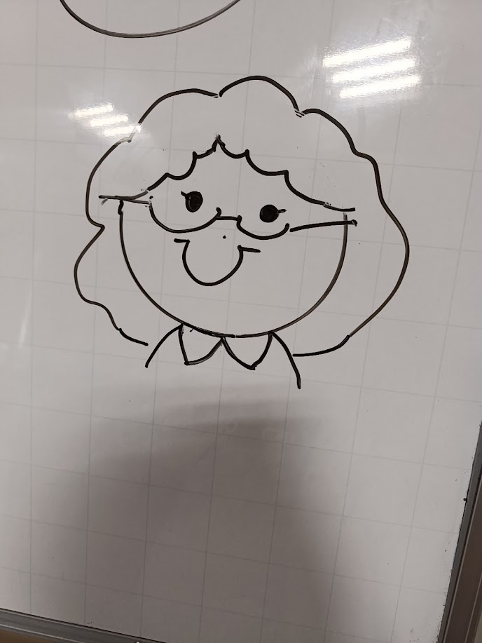

---
tags:
  - "#music"
  - home
  - "#youtube"
title: Accordion 13 years old girl
description: Enjoying life so much with deadlines
---
# Monika Kahl and Teacher's day

## 2026-11-20
[Link is here]([https://www.youtube.com/@mstuchli](https://www.youtube.com/watch?v=w0bAU5SteTQ&t=3s&pp=ygUVbW9uaWthIGthaGwgYWNjb3JkaW9u)) Woah so I just peak an interest in France and I found their culture is very interesting. So I found few woman played the accordion, which is a famous instrument around Europe and mostly France. There they have famous croissant, red wine, French toast, etc. Very rich culture. And what I mentioned is the famous accordion too. Very impressed on how the girl, Monika, accordingly the youngest accordion in France back then. I very love how she played it so well. 

---

> This is Monika Kahl with her accordion

Oh and today's night I also enjoyed some songs. Hurt by New Jeans and The singing in the middle of Pac Bo Forest by Pham Thu Ha. Love learning about culture is how I keen on classical and also modern music? Maybe?

Rewind back to 20th November. We had fun and party in Teacher's day but still have to finished the deadlines, so yikes. But in the end I'm very contented with what I did that day. Give cookies and cakes, had a yogurt drink, helping on drawing the board. I won't show ALL the drawings but of course just a little peak for you guys here.

> Yipe, smiley. Happy Teacher's day

So that's the finale. In the end I'm very chill these days but also got to have finish the deadlines. That is so ass by the way :"D But really though, `20:54` in `2026-11-20` is the 

> Happy Teacher's day by me and bestie group leader