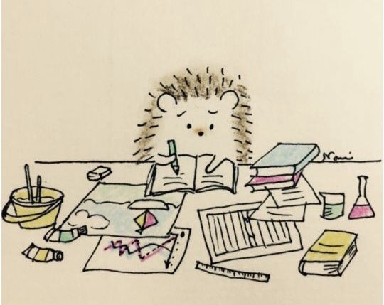

# Thoughts?
#### `08/11/2026`

I just got to in love with this hedgehog by the artist Nami Nashikawa. The hedgehog is cute and simple as I thought as she/he is concentrating on the task that is given, such like dealing with tasks, studying, and doing homework. Just love this hedgehog so much, she/he gave me motivation.

## Side story
#### `08/11/2026`
Having three row in walking this Sunday. It is such a free-blast hehe. I also used an app to track my walking too. This app is called "Walking Charlie", with pixel customization and a bar every time you walk or run. This app is very fun and I got very many productive energy from it

# Nothing to hide
#### `14/11/2026`
Stop chasing fast happiness? So what is actually fast happiness for me?.. The truth is high dopamine detox makes everything sucks. Got to have to focus and train my memory. Nothing to fear, nothing to stop, nothing to be afraid of. Because if I'm still here, I'm well alive and okay. Maybe this fear is running in my blood but I will resolve it peacefully. Nothing to cry, nothing to scared, nothing to left behind. Because anything out of nowhere can happen suddenly.

#cry #athome